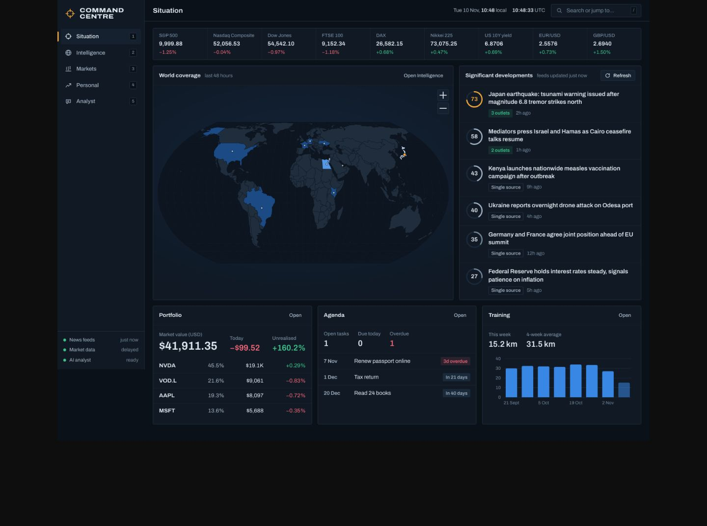
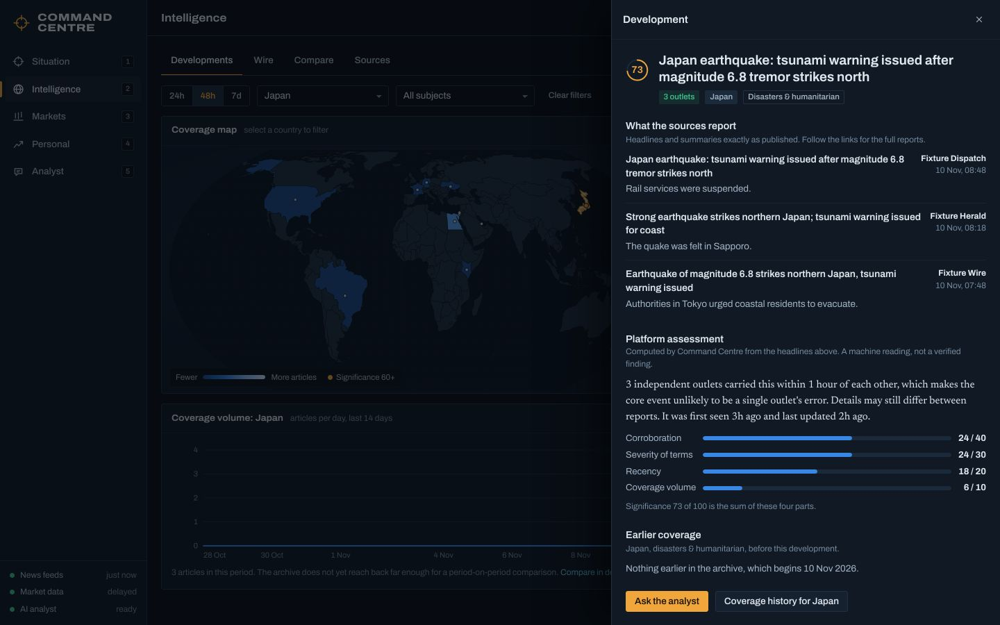
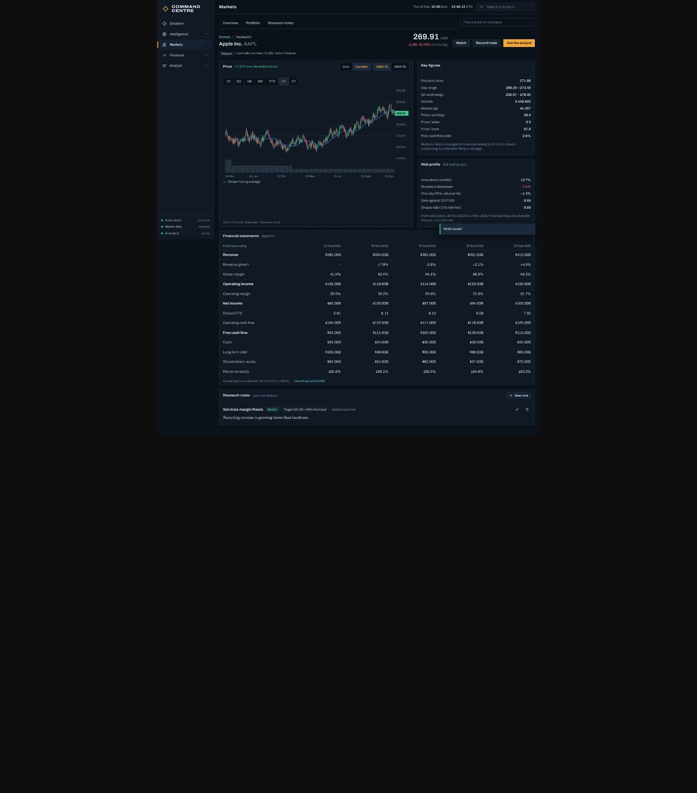
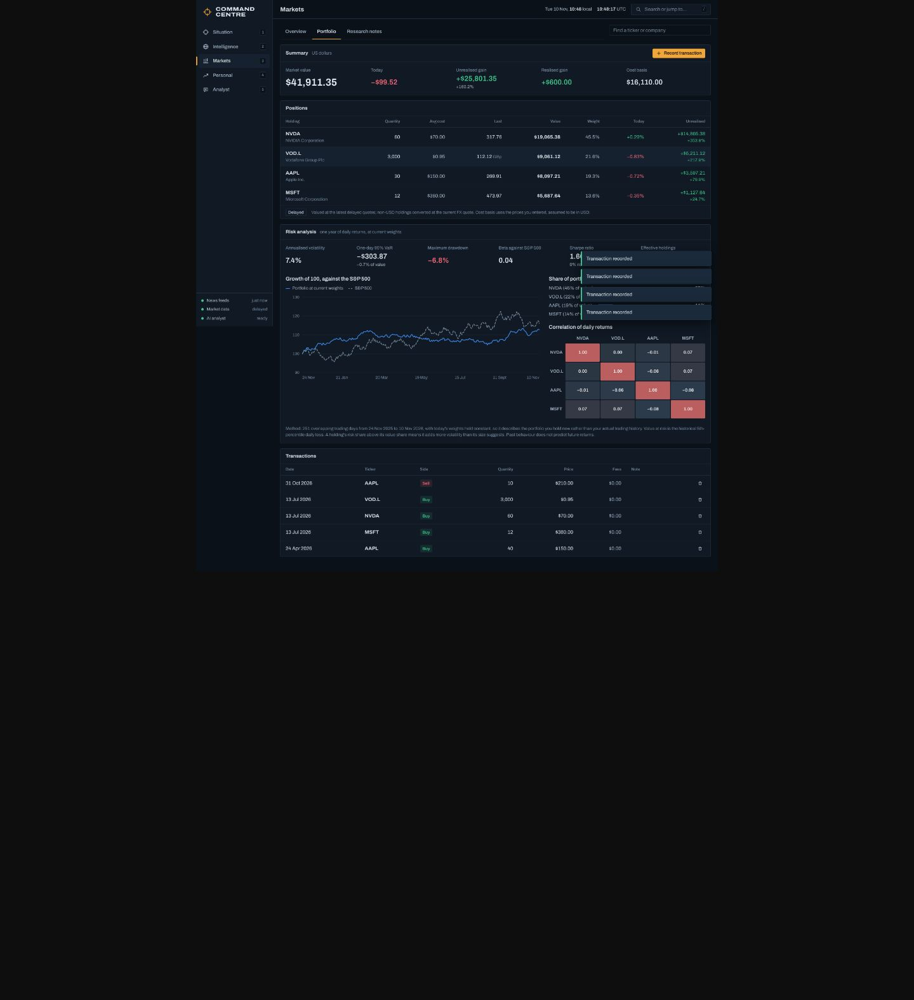
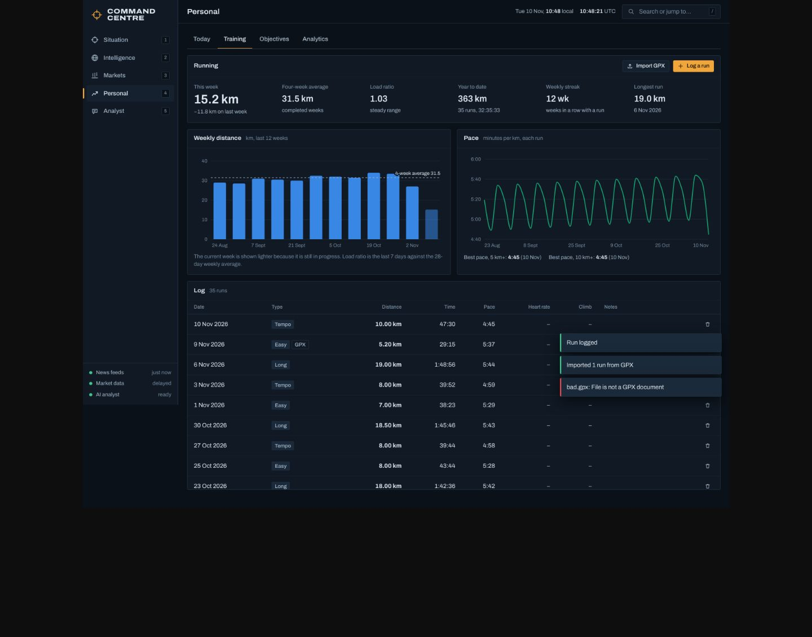
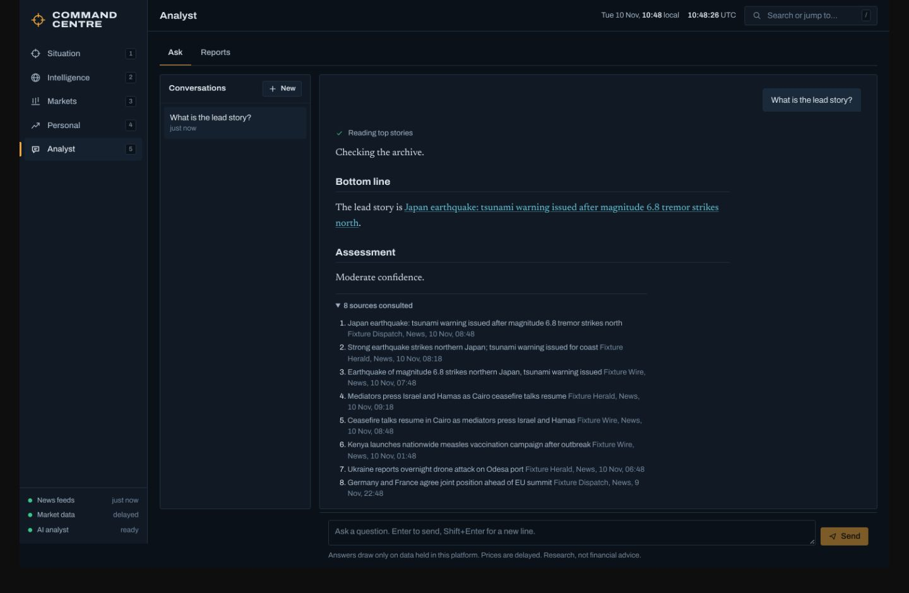

# Command Centre

A personal intelligence platform that runs on your own machine: a news intelligence
desk, a market research terminal, a personal performance dashboard and an AI analyst
that can reason across all three.

It is a single-user application. Your data lives in one SQLite file on your disk.

## Run it

Requires **Node.js 22.13 or newer** (it uses Node's built-in SQLite, so there is
nothing native to compile).

```bash
npm install
cp .env.example .env        # optional: add keys, see "Configuration"
npm run build               # build the web client
npm start                   # http://127.0.0.1:4000
```

For development, `npm run dev` starts the API on port 4000 and the Vite dev server
with hot reload on http://localhost:5173.

On first start the server fetches the configured news feeds, then refreshes them
every 15 minutes. Market data is requested when you open a screen that needs it.

## Configuration

Everything is optional. With no keys at all, news, markets and the personal
dashboard are fully functional, and reports are available as data digests.

| Variable | What it does | Where to get it |
| --- | --- | --- |
| `ANTHROPIC_API_KEY` | Enables the AI analyst (chat and AI-written reports). | https://console.anthropic.com |
| `ANALYST_MODEL` | Model for the analyst. Default `claude-opus-5-5`. | |
| `SEC_USER_AGENT` | Contact string sent to SEC EDGAR, which asks API clients to identify themselves, e.g. `Jane Doe jane@example.com`. Company financials may be refused without it. | Your own name and email |
| `PORT`, `HOST` | Where the server listens. Default `127.0.0.1:4000`. | |
| `DATABASE_PATH` | SQLite file. Default `./data/command-centre.db`. | |
| `NEWS_REFRESH_MINUTES` | Background feed refresh interval; `0` disables it. Default `15`. | |

The app has **no login**. It binds to loopback by default; do not expose it on a
network without putting your own authentication in front of it.

### External services used

| Service | Used for | Key needed |
| --- | --- | --- |
| Public RSS feeds (BBC, The Guardian, Al Jazeera, NPR, The New York Times, Deutsche Welle, France 24, UN News) | News ingestion. Add or pause feeds on Intelligence → Sources. | No |
| Yahoo Finance chart and search endpoints | Delayed quotes, price history, ticker search | No (unofficial public endpoints; they can change or rate-limit) |
| Stooq | End-of-day fallback when Yahoo is unreachable | No |
| SEC EDGAR XBRL "company facts" | Company-filed annual financials (US registrants) | No, but set `SEC_USER_AGENT` |
| GDELT DOC API | Long-range global media attention on the Compare tab | No |
| Anthropic API | AI analyst | Yes |

## What it does

**Situation**: one screen with the market board, a world coverage map, the top
ranked developments, your portfolio, agenda and training week.

**Intelligence**
- Ingests RSS 2.0, RDF and Atom feeds; de-duplicates by URL and strips tracking parameters.
- Tags each article with countries (gazetteer of about 130 countries with demonyms, capitals and disambiguation for names like Jordan, Georgia and Chad) and with nine subjects.
- Groups coverage of the same event into a *development* and ranks it with a transparent 0–100 significance score: corroboration across independent outlets, severity of terms, recency and volume. The breakdown is shown for every story.
- Separates facts from analysis three ways: reporting versus publisher-labelled analysis and opinion; "corroborated by N outlets" versus "single source"; and the platform's own computed assessment set apart (and typeset differently) from what sources reported.
- Every item links to the original publisher.
- Interactive world map (zoom, pan, click to filter) coloured by coverage volume.
- Historical comparison: coverage per day against the preceding period for any country and subject, two countries side by side, and GDELT attention going back up to a year. The local archive starts when you first run the platform, and the UI says so rather than inventing a baseline.
- Source management with per-feed health.

**Markets**
- Market board, watchlist and ticker search. Every price is labelled delayed with its last-trade time and provider; if a provider is down you see the last known value marked stale, or an error, never a made-up number.
- Instrument page: interactive price chart (seven ranges, line or candlesticks, moving averages, volume, crosshair), key figures, five years of filed financial statements with margins and growth, valuation multiples, and a risk profile (volatility, drawdown, value at risk, beta, Sharpe).
- Portfolio: transactions with validation (no selling what you do not hold), average-cost positions, realised and unrealised P&L, FX conversion to USD including London pence quotes.
- Portfolio risk: volatility, historical value at risk, drawdown, beta, concentration, each holding's share of total risk, a correlation matrix and growth against the S&P 500, with the method stated.
- Research notes per instrument with stance and target price.

**Personal**
- Tasks with priorities and due dates; deadlines; one merged agenda.
- Running log: manual entry or GPX import (distance, time, climb and heart rate read from the track). Weekly distance, pace trend, load ratio, streak, bests.
- Objectives with numeric targets (increasing or decreasing), progress history and pace against the deadline.
- Analytics: completion throughput, on-time rate, objective pace, training volume.

**Analyst**
- Chat that answers by calling tools over the platform's own data (news archive, quotes, price history, filed financials, your portfolio and personal records), streamed with visible research steps and a list of sources consulted. Its instructions require sourced facts, a separate assessment, stated uncertainty and no invented figures.
- Reports: daily brief, country, company, comparison and custom. Each can be written by the AI or produced as a deterministic **data digest** that contains only retrieved records and calculations.
- Conversations and reports are saved; reports download as Markdown.

**Throughout**: command palette (`/` or `Ctrl/⌘ K`) across desks, countries and tickers; number keys `1`–`5` switch desks; loading skeletons, empty states with a next action, and error states with retry on every panel; responsive down to phone width.

## Architecture

```
server/                 Express 5 API (TypeScript, run with tsx)
  db.ts                 node:sqlite, WAL, versioned migrations
  lib/                  HTTP client with timeouts and retries, SQLite-backed TTL cache, typed errors
  modules/news/         feeds → classify → cluster → significance; queries and trends
  modules/markets/      provider adapters (Yahoo, Stooq, SEC), risk maths, portfolio
  modules/personal/     tasks, deadlines, runs, objectives, analytics, GPX parsing
  modules/analyst/      tool definitions, streaming agent loop, data digests, persistence
  app.ts                routes, validation (zod), SSE, static client
web/                    React 19 + Vite client
  src/charts/           hand-built SVG charts and the d3-geo world map
  src/pages/            one file per desk
  src/lib/api.ts        client types are imported from the server's return types
tests/
  unit.test.ts          pure logic
  api.test.ts           HTTP API against a mock upstream
  e2e/run.mjs           browser journeys (Playwright)
  fixtures/upstream.ts  mock of every external provider, used only by tests
```

Design decisions worth knowing:

- **Provider failures are first-class.** Upstream responses are cached in SQLite and kept after expiry, so an outage serves the last value flagged `stale` instead of an empty screen. An unknown ticker (404) is distinguished from an outage (502).
- **No fabricated data anywhere in the application.** The app ships with no sample data; the only synthetic data is the test fixture server, which the application never loads.
- **End-to-end types.** The client imports the server's service return types, so an API change that breaks the UI fails `npm run typecheck`.
- **Dates** for tasks and runs are calendar dates in your local time zone, supplied by the browser; news and market timestamps are stored in UTC.

## Tests

```bash
npm run typecheck     # server and client
npm test              # 54 unit and API tests
npm run build && npm run test:e2e   # 19 browser journeys
```

The end-to-end suite needs a Chromium for Playwright: `npx playwright install chromium`.

All tests run offline against `tests/fixtures/upstream.ts`, a local server that
imitates the wire formats of the feeds, Yahoo, Stooq, SEC EDGAR, GDELT and the
Anthropic streaming API.

## Limits

- Prices are delayed and come from unofficial public endpoints. This is a research tool, not a trading system, and nothing in it is financial advice.
- Classification, clustering and significance are rule-based and work from headlines and summaries, not full articles. "Corroborated" means several outlets reported it, not that it has been independently verified.
- Filed financials cover companies that report to the SEC.
- Portfolio cost basis assumes the prices you enter are in USD.

## Screenshots

Captured by the end-to-end suite, so the headlines, prices and personal records
shown are **synthetic test fixtures**, not real data.

| | |
| --- | --- |
|  |  |
|  |  |
|  |  |
